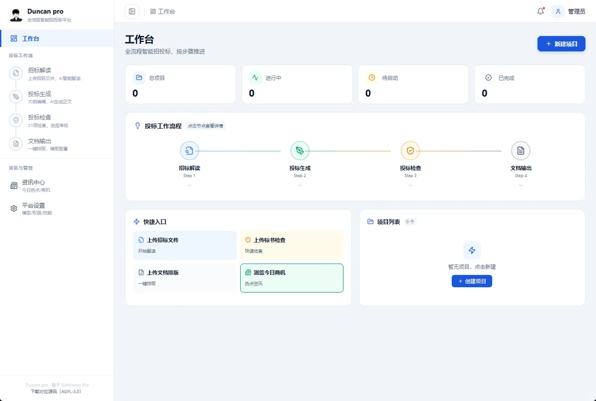
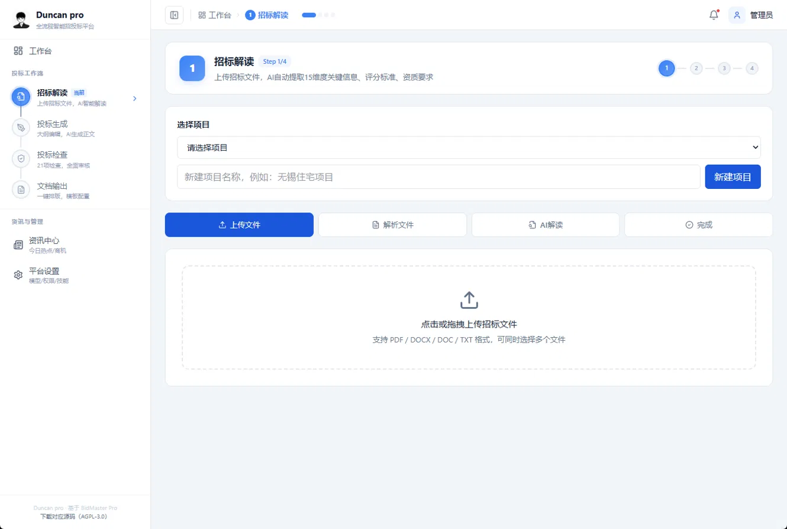
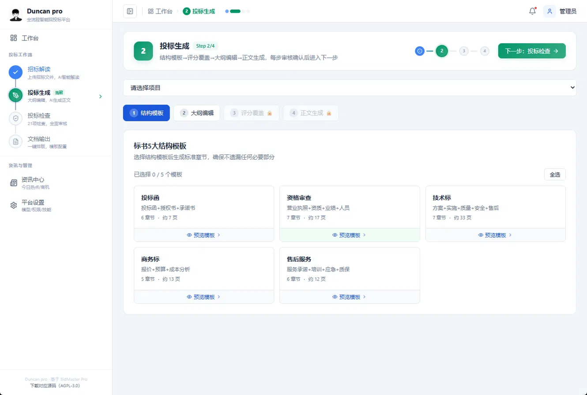
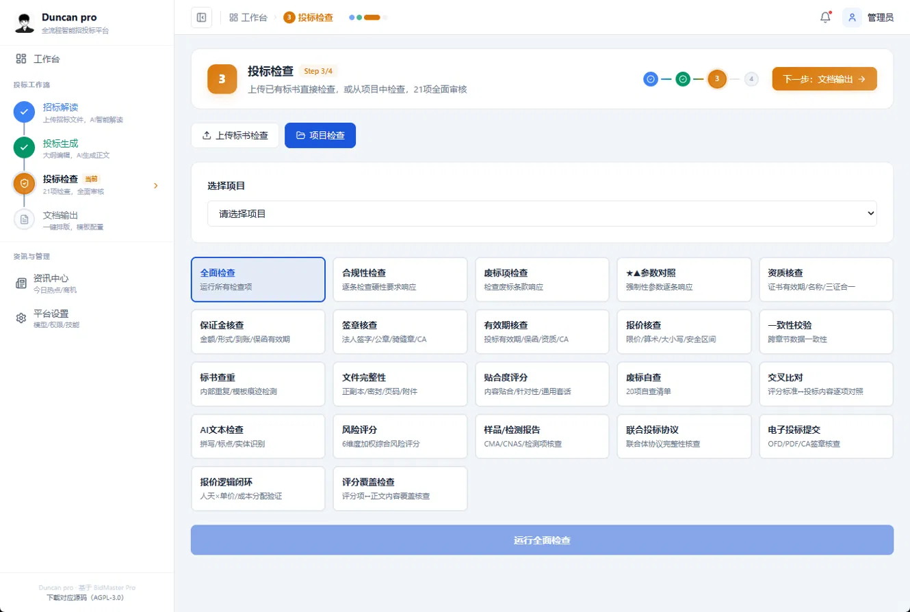
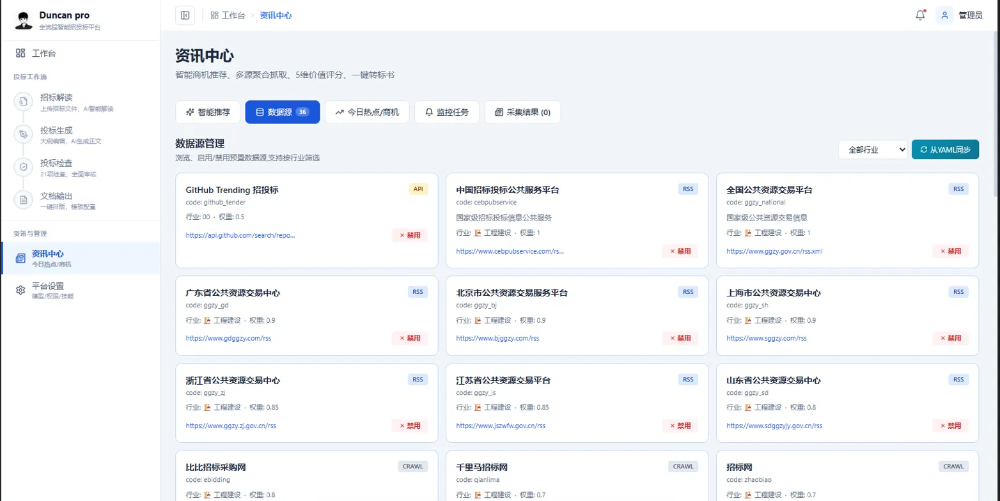

# Duncan pro - 招标文件智能解读平台

上传招标文件 · 提取关键信息 · DeepSeek 分析 · 下载解读报告

[项目简介](#项目简介) · [界面预览](#界面预览) · [功能特性](#功能特性) · [技术架构](#技术架构) · [快速开始](#快速开始) · [项目结构](#项目结构) · [许可证](#许可证)

> Duncan pro 将招标文件的阅读、信息整理和报告输出放在一个网页里。当前重点是**真实文件解读**：上传有文字层的招标文件，提取内容，发起 AI 分析，在电脑或手机上查看结果并下载报告。

---

## 项目简介

招标文件通常篇幅长、信息分散。项目名称、资格条件、评分办法、时间节点和合同要求可能位于不同章节。Duncan pro 先解析文件文字，再按 15 个主题调用 DeepSeek 整理结果，帮助使用者快速建立阅读清单。

完整流程：

1. 创建项目，上传招标文件。
2. 解析文件，确认已经提取到文字。
3. 提交 AI 解读任务，查看进度和各主题结果。
4. 阅读项目、资格、评分、时间、风险等内容，并回到原文件核对。
5. 下载 HTML 或 Markdown 报告；HTML 报告可在手机浏览器离线打开。

本仓库提供可自行部署的源码和 Docker 配置。运行 AI 解读需要自己的 DeepSeek API Key；调用费用由模型服务商按实际用量收取。

---

## 界面预览

以下截图展示 Duncan pro 的页面布局和功能入口。实际可用范围以[当前能力状态](#当前能力状态)为准；目前完成端到端演示的是带文字层 PDF 的招标解读与报告导出。

| 页面 | 预览 |
| --- | --- |
| 工作台 |  |
| 招标解读：上传文件 |  |
| 投标生成：结构模板 |  |
| 投标检查：项目检查入口 |  |
| 资讯中心：数据源管理 |  |

---

## 功能特性

### 1. 项目与文件

- **项目管理**：为不同招标项目分别保存文件和分析结果。
- **文件上传**：接口接受 PDF、DOCX、DOC、TXT、WPS、Markdown；当前端到端演示已核验的是带文字层的 PDF。
- **文字解析**：先提取可读取的文本，再进行 AI 解读；没有提取到文字时明确提示处理文件。
- **文件大小限制**：单文件最高 100 MB，实际解析速度取决于文件内容和电脑资源。

### 2. AI 招标解读

- **15 个主题**：项目信息、甲方信息、资格要求、技术需求、评分细则、废标红线、保证金、开标要求、评标办法、商务评分、合同条款、风险提示、竞争态势、时间节点和关键联系人。
- **真实模型调用**：通过本机配置的 DeepSeek API Key 调用模型；没有配置密钥时无法完成 AI 解读。
- **后台任务**：提交后可查看进度，手机网页无需等待单次长请求。
- **失败状态**：全部失败时显示失败；部分主题失败时标出缺失项，不把错误结果显示为完整报告。

### 3. 结果与报告

- **分主题阅读**：在网页中查看项目、资格、评分、时间、风险等信息。
- **报告下载**：导出 HTML 或 Markdown；HTML 报告可在电脑或手机浏览器打开。
- **人工核对**：金额、日期、资质、评分和废标条件等关键内容，应逐项回查招标原文。

### 4. 手机浏览器

- 登录、招标解读、结果和报告入口适配窄屏。
- 手机侧栏可收起，主要操作按钮可在手机宽度内使用。
- 可通过临时外网链接演示；链接依赖本机服务持续运行。

### 当前能力状态

| 能力 | 状态 |
| --- | --- |
| 带文字层 PDF 上传、解析、DeepSeek 解读、HTML/Markdown 报告 | 已用公开文件完成端到端演示 |
| DOCX、DOC、TXT、WPS、Markdown | 接口支持上传；各格式尚未逐一完成端到端验收 |
| 扫描版 PDF OCR | 当前演示未接入 |
| 自动生成完整投标书、全套合规审核、企业生产部署 | 不属于当前已验收能力 |

---

## 技术架构

```text
浏览器 / 手机浏览器
        │
        ▼
React + TypeScript + Vite 网页
        │ 由 Nginx 托管并转发 /api
        ▼
FastAPI 业务接口
   ├── 项目与文件管理 ─── MySQL
   ├── 文件文字解析 ───── Docker 数据卷
   ├── 解读任务与报告
   └── DeepSeek 模型调用 ─ DeepSeek API

Redis 作为演示编排中的基础服务
```

| 部分 | 使用的技术 |
| --- | --- |
| 网页界面 | React 19、TypeScript、Vite 7 |
| 后端接口 | Python 3.12、FastAPI |
| 演示数据 | MySQL 8、Docker 数据卷 |
| 容器编排 | Docker Compose、Nginx |
| AI 解读 | DeepSeek API，通过本机环境文件配置 |

解读任务状态目前保存在单个 API 进程内存中。API 容器重启后，正在运行的任务需要重新提交。

---

## 快速开始

以下步骤以 **Windows 10/11 + Docker Desktop** 为例。下载源码本身不需要 Docker；运行网页、数据库和后端需要 Docker。

### 环境要求

- 已安装并启动 Docker Desktop，支持运行 Linux 容器。
- 电脑能够访问 DeepSeek API。
- 准备自己的 DeepSeek API Key；AI 调用按用量计费。

### 1. 获取源码

```powershell
git clone https://github.com/Duncan-maker117/Duncan-Pro.git
cd Duncan-Pro
```

也可以在 GitHub 页面点击 **Code → Download ZIP** 下载源码。

### 2. 配置 DeepSeek 密钥

双击项目根目录的 `设置DeepSeek密钥.bat`，按窗口提示在本机输入密钥。脚本将它写入被 Git 忽略的 `.env.local`；不要把该文件提交到仓库或发给他人。

### 3. 启动服务

在项目根目录的 PowerShell 中执行：

```powershell
docker compose --env-file .env.local -f docker/docker-compose.duncan.yml up -d --build
```

首次构建需要下载镜像和安装依赖，时间取决于网络。启动后打开 [http://127.0.0.1:8081](http://127.0.0.1:8081)。

### 4. 初始化管理员并登录

首次启动且容器就绪后，在项目根目录执行：

```powershell
powershell -NoProfile -ExecutionPolicy Bypass -File .\scripts\初始化演示管理员.ps1
```

脚本生成随机密码并保存在本机 `.secrets/admin-password.txt`。登录邮箱是 `admin@bidmaster.pro`；可双击 `查看演示密码.bat` 查看本机密码。邮箱是**平台登录账号**，无需能接收邮件。

### 5. 运行一次解读

进入“招标解读” → 新建项目 → 上传带文字层的 PDF → 解析文件 → AI 解读 → 查看结果 → 下载报告。

停止服务：

```powershell
docker compose --env-file .env.local -f docker/docker-compose.duncan.yml down
```

上述停止命令会保留数据卷。运行 `down -v` 会删除本地容器数据，请在确认数据可删除后使用。

---

## 配置与手机访问

| 配置 | 作用 | 保存位置 |
| --- | --- | --- |
| `LLM_API_KEY` | DeepSeek API Key | 本机 `.env.local` |
| `LLM_MODEL` | AI 模型，脚本设置为 `deepseek/deepseek-flash` | 本机 `.env.local` |
| `MYSQL_ROOT_PASSWORD` / `MYSQL_PASSWORD` | MySQL 密码；对外部署前必须更换演示默认值 | 本机环境配置 |
| 管理员随机密码 | 登录平台 | 本机 `.secrets/admin-password.txt` |

如需短时间用手机查看，可在服务运行后双击 `启动手机演示.bat`。脚本会生成临时 `trycloudflare.com` 链接；电脑、Docker、脚本窗口和网络都需保持运行。该链接目前只有**平台登录**保护，适合短时演示，不适合作为长期公开服务。操作与限制见 [手机演示说明](duncan-docs/部署.md)。

---

## 项目结构

```text
Duncan-Pro/
├── packages/desktop/renderer/   网页界面
├── services/                    FastAPI 接口与业务逻辑
├── services/interpret/          解读与报告逻辑
├── core/doc_engine/             文件解析能力
├── docker/                      Docker 镜像与编排
├── scripts/                     密钥、管理员、手机演示脚本
├── duncan-docs/                 部署、结构、变更和验收记录
└── samples/来源.txt             演示文件的公开来源
```

后续修改的入口和约束见 [项目结构与修改入口](duncan-docs/项目结构.md)。本地验收记录和已知问题分别见 [验收记录](duncan-docs/验收记录.md)、[缺陷与限制](duncan-docs/缺陷与限制.md)。

---

## 使用边界

- **AI 结果需要复核**：长文档可能出现遗漏或误读；平台不替代法律、商务或专业投标审查。
- **扫描件需要先处理**：无文字层 PDF 当前不会自动 OCR。
- **公开部署需要加固**：演示编排含默认数据库密码；面向企业长期使用前，应更换密码并补充账号管理、访问控制、备份、审计与数据隔离。
- **GitHub 提供源码**：克隆仓库后可以在自己的电脑运行；仓库地址本身不是在线使用地址。

---

## 许可证

本仓库适用 [GNU Affero General Public License v3.0](LICENSE)。公开提供修改版网络服务时，应按该许可证向用户提供对应源码。API Key、管理员密码、上传文件、数据库数据和运行日志不包含在公开源码中。
